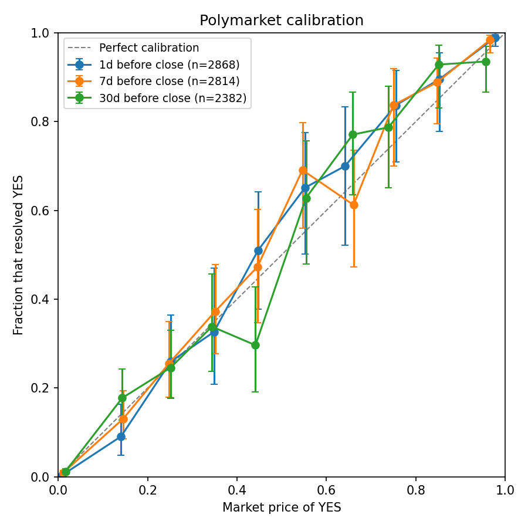
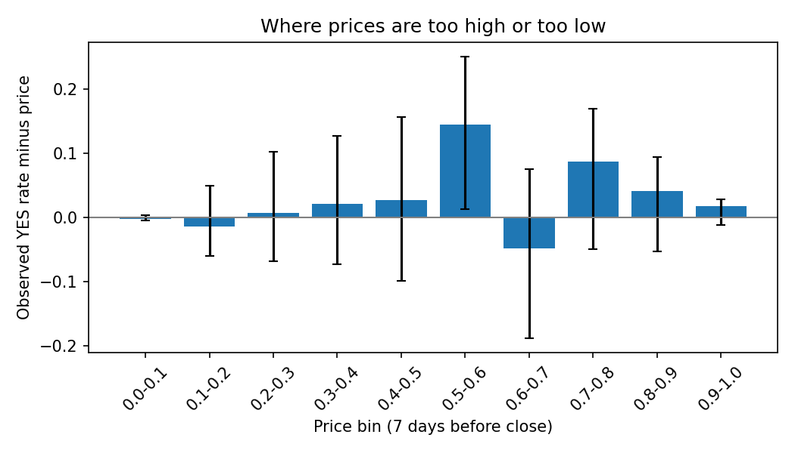
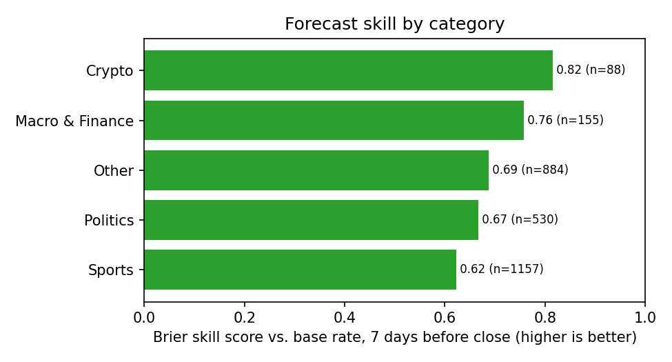

# How well calibrated is Polymarket?

When a Polymarket contract trades at 70 cents, does the event happen about 70% of the time? This project tests that on **2,975 resolved yes/no markets** (each with at least $50K of volume) that closed between January 2025 and October 2026, using prices 1, 7 and 30 days before each market closed.



## Key findings

1. **Prices are well calibrated.** Seven days before close, the average gap between price and outcome frequency (expected calibration error) is 1.1 percentage points. In 9 of the 10 price bins, the 95% interval for the observed YES rate contains the average price; the exception is the 50–60% bin, where events happened more often than priced.
2. **Accuracy improves as resolution approaches.** The Brier skill score (improvement over always predicting the base rate) rises from 0.57 at 30 days to 0.68 at 7 days and 0.79 at 1 day.
3. **No classic favorite–longshot bias.** A recalibration fit, logit P(YES) = a + b·logit(price), gives b = 1.12 (95% CI 1.02–1.26) at 7 days. A slope below 1 would mean prices are too extreme (long shots overpriced); a slope slightly above 1 suggests prices are, if anything, a little too moderate.
4. **But that "edge" does not survive out of sample.** Fitting the recalibration on the earlier half of markets and applying it to the later half made the Brier score slightly worse (0.0423 → 0.0432; 95% CI of the improvement -0.0020 to 0.0001). The in-sample pattern is not a reliable trading signal, so I would not trade it.
5. **Contested markets are the real test.** Many markets are long shots priced near 0, which flatters accuracy. Restricting to markets priced between 10% and 90% seven days out (605 markets), the Brier skill score is 0.29 and calibration error is 3.9 points: still informative, but far from certain.

| Horizon | Markets | Events | Brier | Brier skill | Calibration error | Recalibration slope [95% CI] |
|---|---|---|---|---|---|---|
| 1d | 2,868 | 766 | 0.030 | 0.79 | 0.012 | 1.26 [1.12, 1.50] |
| 7d | 2,814 | 769 | 0.045 | 0.68 | 0.011 | 1.12 [1.02, 1.26] |
| 30d | 2,382 | 631 | 0.055 | 0.57 | 0.016 | 1.08 [0.99, 1.21] |

### By category (7 days before close)

| Category | Markets | Events | Brier skill | Calibration error |
|---|---|---|---|---|
| Crypto | 88 | 43 | 0.82 | 0.084 |
| Macro & Finance | 155 | 49 | 0.76 | 0.056 |
| Other | 884 | 335 | 0.69 | 0.021 |
| Politics | 530 | 154 | 0.67 | 0.025 |
| Sports | 1,157 | 196 | 0.62 | 0.022 |

Crypto and Macro have small samples, so their estimates are noisy.




## Method

- **Data.** Market metadata and final outcomes from the public Gamma API; YES-token price history from the CLOB `prices-history` endpoint. Only binary Yes/No markets that resolved cleanly to 0 or 1 are kept.
- **Prices.** For each horizon (1, 7, 30 days), I take the last traded price at or before that time, or the nearest price within one day.
- **Metrics.** Brier score, log loss, Brier skill score against the base rate, expected calibration error over 10 price bins, and a logistic recalibration slope.
- **Uncertainty.** Markets inside the same event (for example, every golfer in one tournament) are correlated, so confidence intervals come from a bootstrap that resamples whole events, not single markets. Bin intervals are Wilson intervals.
- **Out-of-sample check.** Markets are split by close date; the recalibration is fitted on the earlier half and scored on the later half.
- **Categories** are assigned with simple keyword rules on the market question and event title, so they are approximate.

## Limitations

- Prices are mid-market traded prices, not executable quotes; fees, spreads and depth are ignored.
- Only markets with at least $50K volume are included; thinner markets may behave differently.
- Most markets are legs of multi-outcome events, so the effective sample size is closer to the number of events than the number of markets.
- The sample covers January 2025 to October 2026 only.

## Reproduce

```bash
python3 fetch_data.py      # ~30-40 min; writes data/markets.csv and data/prices.csv
python3 analyze.py         # writes figures/ and results/
```
Requires Python 3 with pandas, numpy and matplotlib. `data/prices.csv` is not committed because of its size; rerun `fetch_data.py` to rebuild it.

## Files

- `fetch_data.py` — downloads resolved markets and price histories (resumable)
- `analyze.py` — calibration metrics, bootstrap intervals, out-of-sample test, figures
- `results/summary.json` — all headline numbers
- `results/calibration_7d.csv` — calibration table by price bin
- `data/markets.csv` — the market sample used

*Author: Caroline Song ([GitHub](https://github.com/carol-747))*
